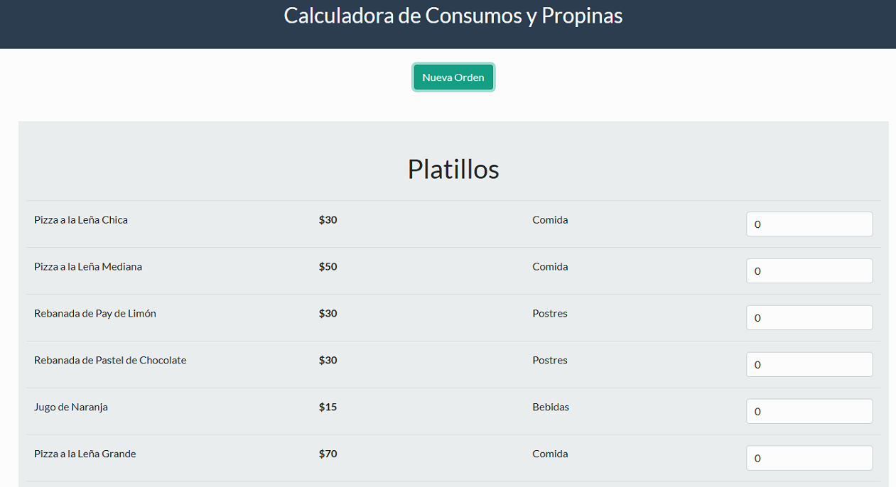
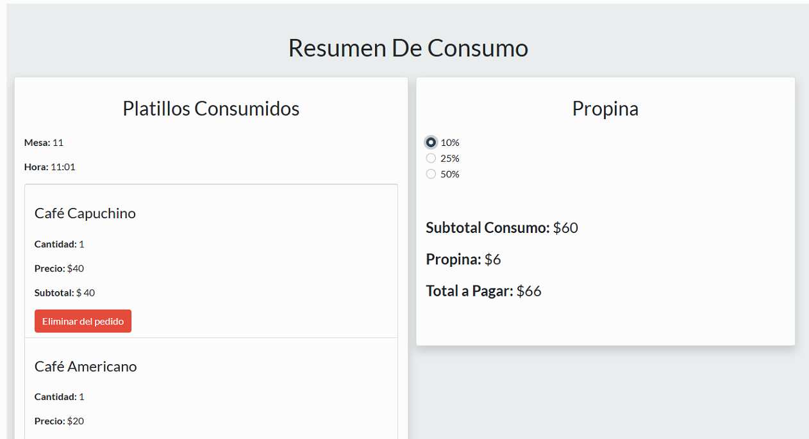

# 🍽️ Calculadora de Consumos y Propinas

Aplicación web para registrar una orden de restaurante, consultar platillos desde una API local y calcular el subtotal, la propina y el total a pagar. El proyecto utiliza **JavaScript**, **Bootstrap** y **JSON Server** como API REST de desarrollo.

## ✨ Funcionalidades

- Crear una orden indicando el número de mesa y la hora.
- Consultar platillos organizados por categoría: comida, bebidas y postres.
- Agregar productos al pedido y cambiar sus cantidades.
- Ver el precio y subtotal de cada producto.
- Eliminar productos del pedido.
- Calcular la propina con opciones del 10 %, 25 % y 50 %.
- Consultar el subtotal de consumo, la propina y el total.
- Validar que la mesa y la hora estén indicadas antes de crear la orden.

## 🖥️ Demo en vivo

**Enlace:** [Ver demo](https://calcularpropinas.netlify.app/)


## 📸 Capturas de pantalla

<!-- Captura principal de la aplicación -->


<!-- Captura del pedido y el cálculo de propina -->


## 🧰 Tecnologías

- **HTML5** para la estructura de la aplicación.
- **CSS y Bootstrap 5** para los componentes y el diseño adaptable.
- **JavaScript** para gestionar el pedido y actualizar la interfaz.
- **Fetch API** para consultar los platillos.
- **JSON Server** para simular una API REST usando `db.json`.

## 🚀 Cómo ejecutar el proyecto

### Requisitos

- [Node.js y npm](https://nodejs.org/) para ejecutar JSON Server.
- Un servidor local para abrir la aplicación, por ejemplo, la extensión **Live Server** de Visual Studio Code.

### Pasos

1. Clona el repositorio y entra en la carpeta del proyecto:

   ```bash
   git clone <URL_DEL_REPOSITORIO>
   cd <CARPETA_DEL_PROYECTO>
   ```

2. Inicia JSON Server desde la raíz del proyecto:

   ```bash
   npx json-server --watch db.json --port 3000
   ```

   La API de platillos estará disponible en `http://localhost:3000/platillos`.

3. Abre `index.html` con Live Server u otro servidor local. No abras el archivo directamente desde el sistema de archivos: la aplicación necesita consultar la API.

## 📂 Estructura del proyecto

```text
.
├── css/
│   └── bootstrap.min.css
├── js/
│   ├── app.js
│   └── bootstrap.bundle.min.js
├── db.json
└── index.html
```

## 📚 Aprendizajes del proyecto

- Manipulación del DOM para crear y actualizar elementos dinámicamente.
- Manejo de eventos de formulario e interacción con botones e inputs.
- Uso de `fetch` y promesas para obtener datos de una API REST.
- Administración del estado de una orden mediante objetos y arreglos.
- Uso de métodos de arreglos como `map`, `filter`, `some` y `forEach`.
- Cálculo de subtotales, porcentajes de propina y totales.
- Validación de campos y presentación de mensajes al usuario.
- Organización de una interfaz con componentes de Bootstrap.

## 📝 Notas

- Los datos de los platillos se encuentran en `db.json`.
- JSON Server debe permanecer ejecutándose mientras se usa la aplicación.
- La orden se administra en el navegador; el proyecto no guarda órdenes en el servidor.
- Para publicar la aplicación, configura una API accesible desde internet y sustituye la URL local en `js/app.js`.
---
## 👨‍💻 Autor 👑

📞 Contacto
- Para más información sobre el proyecto o servicios de desarrollo web: 

- ## JEB$DEV  de   Javier Berchtold.
- ** -Desarrollador FrontEnd - **

- Mi GitHub [Link GitHub](https://github.com/JEB76-22)
- Mi LinkedIn [Linke In](https://www.linkedin.com/in/javier-berchtold-4270a7182/)
- Mi Correo [Contacto](mailto:j.e.b.inter@gmail.com)

